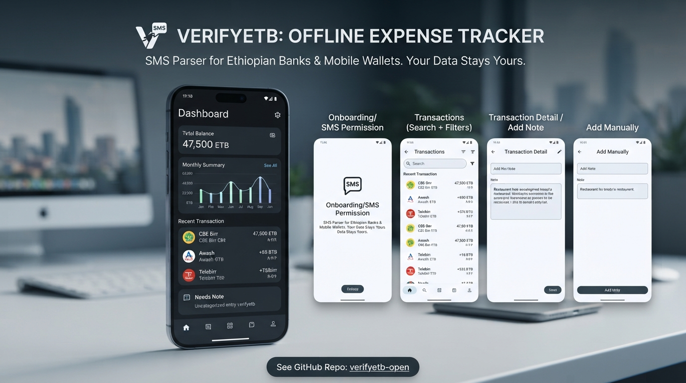

# Verifyetb

> Offline Android expense tracker for Ethiopian banks and mobile wallets.
> No account. No server. Your data stays on your phone.

[](LICENSE)
[](#)
[](#)

## Screenshot

<p align="center">
  
</p>

## What this is (and isn't)

**Verifyetb is an SMS parser and automatic bank/wallet auditor.** It reads the
transaction SMS that Ethiopian banks and mobile wallets already send to your
phone and turns them into a clean, searchable, auditable expense log —
completely offline.

It is **not** a payment verifier. It never moves money, never confirms a
payment to a third party, and never acts as a verification service. It only
parses and organizes the messages already on your device.

**Want a payment verifier instead?** You can build your own verifier app and
plug into the Verifyetb verification API. Get an API key from
[verifyetb.site/workspace](https://verifyetb.site/workspace) and use that key in
your own verifier app to verify payments against the parsed data.

## What it does

Verifyetb reads the transaction SMS your Ethiopian bank or mobile wallet
already sends to your phone and turns them into a clean, searchable expense
log — completely offline.

Supported institutions (via SMS):

- **Banks:** CBE, Awash, Dashen, BOA, Abyssinia, Zemen, Wegagen, Nib,
  Amhara, Oromia, Berhan, Hibret, Siiqee, Hijra, Ahadu, Abay, ZamZam, …
- **Wallets:** Telebirr, M-Pesa, CBE Birr, eBirr, Amole, and more.

## Features

- 📱 **Offline-first** — no account, no cloud, no tracking.
- 💬 **SMS auto-import** — parses debit/credit/fee/airtime messages.
- 💰 **Balances & accounts** — per-institution balances with manual overrides.
- 🔍 **Search & filters** — by institution, type, period, fees-only.
- 📝 **Notes** — attach notes to any transaction.
- 📊 **Insights** — monthly summaries and spending breakdowns.
- 🌍 **Amharic-friendly** — built for the Ethiopian market.

## Screens

1. Onboarding / SMS permission
2. Dashboard — balance, month summary, recent list, needs-note prompt
3. Transactions — search + filters
4. Transaction detail / add note
5. Add manually
6. Settings — SMS scan, reprocess, categories, full institution list

## Build

Requirements: JDK 17, Android SDK (compileSdk 35).

```bash
./gradlew :app:testDebugUnitTest
./gradlew :app:assembleDebug
```

Release builds require a `keystore.properties` file (see `app/build.gradle.kts`).

## Contribute & tweak it however you want

This project is fully open source (MIT). You're free to fork it, modify it,
rebrand it, or build something entirely new on top of it — no permission
needed. Tweak the parsers, add your own bank, change the UI, or turn it into
a different product altogether. Contributions of all kinds are welcome; see
[CONTRIBUTING.md](CONTRIBUTING.md).

Adding a new bank/wallet? Parsers live in
`app/src/main/java/com/verifyetb/app/parser/` — follow the existing pattern and
register the institution in `EthiopianInstitutions.kt`.

## License

[MIT](LICENSE) © TheWadeh
# verifyetb-open
